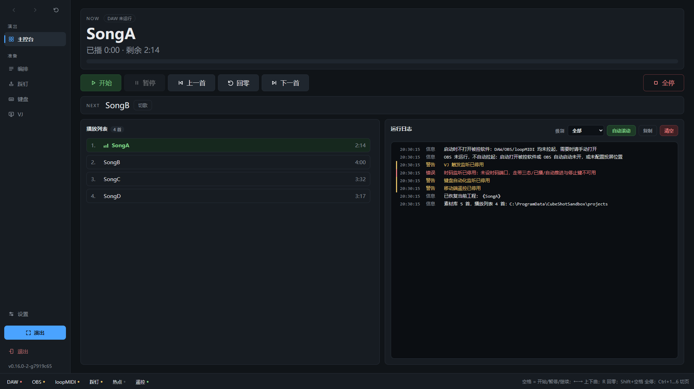
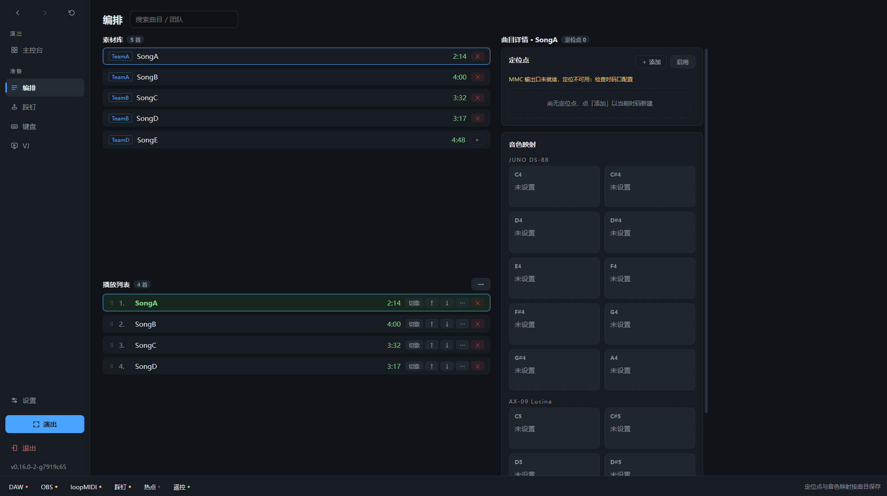

# Cube Setlist Manager

**Cubase / Studio One 演出歌单控制台 · 移动端遥控 · 谱面自动翻页**

[下载安装包](https://github.com/Hab1nA/CubeSetlistManager/releases/latest)
· [演出验证清单](docs/演出验证清单.md)
· [配置参考](docs/配置参考.md)
· [开发指南](docs/开发指南.md)

---

为现场演出准备的自动化套装：Windows 主程序 **Cube Setlist Manager**（Cubase / Studio One 双底座）+ 移动端遥控 APP **Cube Remote**（安卓 / iOS）。演出时一条流走完：素材库编排播放列表 → 一键切换 DAW 工程 → 播完自动切下一首 → JUNO-DS 音色跟着工程走。深色大字界面，暗场可读；全程本地通信，不经互联网。

上：主控台——NOW/NEXT 大字、走带钮组、播放列表与运行日志；下：编排——素材库｜播放列表｜曲目详情三列

## 它能做什么

- **歌单编排**：素材库双击或多选批量加入播放列表，搜索过滤，拖动排序；
- **一键切歌**：双击歌单切换 DAW 工程；有工程在开时两段确认防误触；
- **自动推进**：播到工程终点自动停止并切下一首；中途手动停不切；
- **音色自动切换**：切歌时 JUNO-DS / AX-09 Lucina 自动调用该曲映射的音色；
- **踩钉控制**：MIDI / 蓝牙踩钉学一次即可用——单击、双踩、长踩三种手法，
  暂停/继续、开始、回零、全停、上一首、下一首六个动作；
- **移动端遥控**：平板/手机连热点或路由器局域网，浏览器即开即用；
- **谱面自动翻页**：DAW 发翻谱音符，平板按你选的方法在谱面 App 自动翻页；
- **VJ 视频联动**：走带跟随自动播/停 OBS 视频，节目画面投影指定显示器；
  可静音播放、一键黑场，每个视频槽位可切「播一遍停 / 循环」；
- **定位点**：每首歌可标记多个定位点，主控台一键跳转；
- **启动自检 / 收尾**：loopMIDI / OBS / DAW 未运行自动拉起；退出时可按序
  优雅关闭三者。

## 产品组成

| 产品 | 平台 | 作用 |
|---|---|---|
| **Cube Setlist Manager** | Windows · Cubase 13–15 / Studio One 7 Pro | 演出主程序：歌单、切歌、走带、自动推进与音色/踩钉/VJ 全联动。底座在设置页选择，切换重启生效 |
| **Cube Remote** | Android 8.0+ | 遥控 + 翻谱 APP：控制页与网页同源，另承载翻谱设置 |
| **Cube Remote for iOS** | iOS / iPadOS 16+ | 与安卓版同一张遥控页；翻页走 CoreMIDI。需源码构建，见 [docs/ios.md](docs/ios.md) |

两者都在 [Releases](https://github.com/Hab1nA/CubeSetlistManager/releases/latest) 下载：
`CubeSetlistManager-Setup-x.y.z.exe`（主程序安装包）+ `CubeRemote-vX.Y.z.apk`
（安卓 APP，亦可装好电脑端后连热点经网页「下载 APP」获取）。

> **从旧「双版本」升级**（Cubase / Studio One 两个独立安装包的时代）：先卸载
> 两个旧版再装合一版——并存会双跑双发走带键。旧 Cubase 版可原地升级
> （AppId 沿用）；旧 Studio One 版卸载后装合一版，再到设置页把底座切到
> Studio One 重启即可。
>
> **Cube Automator Studio One**（简化版）自 v0.16.0 起停止发行；其场景已由
> 合一版切 Studio One 底座覆盖，源码入口保留（见[开发指南](docs/开发指南.md)）。

## 环境要求

- Windows 10/11（深色圆角标题栏依赖 Win11 特性）；
- [loopMIDI](https://www.tobias-erichsen.de/software/loopmidi.html)：虚拟 MIDI
  端口，装好后由主程序自动拉起；
- OBS Studio 28+（obs-websocket 5.x 已内置，需在「工具 → WebSocket 服务器
  设置」启用）；
- DAW 二选一：
  - **Steinberg Cubase 13–15**（实测 13.0.40 / 15）——走带与切歌经官方
    MIDI Remote 直控，需一次性部署三步（约两分钟，见快速开始第 4 步；
    不部署则走带动作不可用）；
  - **PreSonus Studio One 7 Pro**（实测 7.2）——走带时钟需在
    「歌曲选项 → 同步」勾选 **MIDI 时码输出** 到主程序的时码端口；
- 硬件可选：Roland JUNO-DS88、Roland AX-09 Lucina（仅 USB 可接收）、
  MIDI 或蓝牙踩钉；
- 移动端可选：安卓 8.0+ / iOS 16+ 设备，或任意现代浏览器。

## 快速开始

1. **安装**：下载安装包双击安装——按用户安装到
   `%LOCALAPPDATA%\Programs\CubeSetlistManager`（免管理员），自动创建
   开始菜单/桌面快捷方式，自带卸载器；升级直接装新版，数据保留。
   `config.json`、`playlist.json` 放 exe 同目录（安装根目录）。
2. **首次配置**：把 `config.example.json` 复制为 exe 同目录的
   `config.json`，改 OBS 地址/密码、DAW 路径、工程库与视频目录
   （全字段见[配置参考](docs/配置参考.md)）；
3. **准备素材**：工程按 `<队伍>/<歌>/<歌>.cpr`（Studio One 为 `.song`）
   放进工程库根目录，视频放进 VJ 视频目录；歌名来源=工程文件名；
4. **Cubase 用户加一步**（一次性部署 MIDI Remote 直控，全程不抢焦点）：
   - 在 loopMIDI 里新建端口，命名 `CubeSetlist Remote`（严格同名，勿加
     后缀）；
   - 把仓库 `mr_driver/Local/CubeSetlistManager/CubeSetlistRemote/` 按同样
     目录层级拷到 `%USERPROFILE%\Documents\Steinberg\Cubase\MIDI Remote\Driver Scripts\Local\CubeSetlistManager\CubeSetlistRemote\`；
   - 重启 Cubase，「Studio → MIDI Remote Manager」确认
     `CubeSetlistManager CubeSetlistRemote` 已自动填上该端口（罕见未连时
     手选该口）。
5. **启动主程序**：启动自检自动拉起三大后端并写日志——loopMIDI 端口就绪、
   OBS 启动并等 WebSocket（至多 30 秒）、DAW 冷启动（Cubase 约 30 秒到 Hub，
   Studio One 同实例换歌约 1–2 秒）；任一失败只记日志不阻断其余功能；
6. **移动端遥控/自动翻谱**：设置页勾「启用移动端遥控」，服务网络选
   「自动开热点」或「用现有局域网」，平板/手机连入后浏览器遥控即开即用；
   翻谱装 Cube Remote APP，在 APP 内完成认领/翻页方法/无障碍授权；
7. **音色与踩钉绑定**：见下文功能详解。

## 界面速览

主界面为本地渲染的 Web 窗口，侧边栏六页：

| 页 | 用途 |
|---|---|
| **主控台** | NOW/NEXT 大字+进度、走带钮组、播放列表与运行日志双列、定位点快跳 |
| **编排** | 素材库｜播放列表｜曲目详情三列；详情面板配置定位点与逐曲音色映射 |
| **踩钉** | 连接状态、平板转发、最近事件、输入设备、功能绑定点行学习 |
| **键盘** | 当前曲音色配置、JUNO-DS 与 AX-09 端口、全局移调键位 |
| **VJ** | OBS 连接、触发槽位、视频联动、显示位置与静音 |
| **设置** | 联动端口、行为开关、目录与工程、移动端遥控 |

常用操作：

- **加入/移出**：素材库行尾「＋」加入播放列表；已加入行「✕」两段确认后
  移出；点行=进详情编辑；
- **切歌**：行内「切歌」钮 / 双击行 / 主控台 NEXT 卡与定位点快跳；
- **录音色**：详情面板点音色槽卡=录制，到琴上选音色自动捕获，「测试」
  试听、「✕」清除；
- **学踩钉**：踩钉页点行即开始学习（再点取消），踩一下完成绑定，全部
  即改即生效；
- **快捷键**：空格=开始/暂停/继续；←→=上一首/下一首；R=回零；
  Shift+空格=全停；Ctrl+1…6=切页；F11/ESC=演出模式进出；
- **演出模式**：大字居中全屏、窗口自动置顶，适合投屏暗场；
- **设置页**：保存即应用；端口下拉列当前在线端口，已存端口不在线时显示
  「（当前不可用）」，不动它保存则保留原设定。

## 功能详解

### 自动推进

主程序经 MTC 时码监控播放位置，播到工程终点附近主动发停止并自动切
播放列表下一首；中途手动停止或暂停不触发切换。工程时长自动从工程文件
解析（未识别的曲目在播放列表手填，否则该曲不自动切换）。时码端口在
设置页选择；停用时走带三态/已播时长/自动推进均不可用。

### 音色自动切换（键盘自动化）

DAW 向主程序的键盘自动化端口发音符，主程序转发到琴上切音色：
**C4–A4（72–81）→ JUNO-DS，C5–F5（84–89）→ AX-09 Lucina**（音名与
Cubase / Studio One 界面显示一致）。

- **录制映射**：详情面板或键盘页点「录制」，JUNO 在琴上按 Favorite、
  AX-09 在琴上选中音色（**先把 AX-09 的 MIDI 设置 Bn 开为 ON**：
  SHIFT+V-LINK 连按 5 次，改完 SHIFT+WRITE），软件从 MIDI 输入自动捕获，
  存工程文件夹 `keyboard_automation.json`；
- **选琴的 MIDI 口**：键盘页「MIDI 输出」（触发/发送）与「MIDI 输入」
  （录制捕获）两行下拉在线枚举，收发两口异名的盒子（如 WIDI U-Host）
  各选各的，同名双向口选输出后输入自动跟随；
- **蓝牙接法**（BLE MIDI，如琴上插 CME WIDI U-Host 连电脑内置蓝牙）：
  BLE 端点以「名（BLE）」出现在同一下拉，选中即收发全走蓝牙；
- AX-09 只能经 USB 接收（DIN 口 OUT-only）；BS/PC 直发 144 个常规音色，
  Favorite / Special Tone 不在 MIDI 映射表里。

### 踩钉

- **两类设备同套学习**：MIDI CC 踩钉（瞬时/开关通吃）与蓝牙键盘型踩钉
  （HID 按键）；
- **六个动作**：暂停/继续（按播放状态一键切换）、开始、回零、全停、
  上一首、下一首；
- **三种手法**：单击、快踩两下（双踩）、踩住约半秒（长踩）；
- **热插拔**：断开每 10 秒自动重连；
- **平板转发冗余路**：踩钉 USB-C 有线连平板，Cube Remote 经 WiFi 转发
  电脑，与蓝牙直连互为备份；APP 侧「踩钉转发」与踩钉页「允许平板转发
  踩钉」双开生效，断网丢包不重放陈旧走带动作。

### 移动端遥控与谱面翻页

- **网页遥控**（零安装）：平板/手机连入与电脑相同的网络（热点或局域网）
  后访问 `http://<电脑IP>:8765`，与桌面同权控制走带/切歌/全停，界面随
  设备尺寸自适应（手机竖屏单列紧凑版）；
- **Cube Remote APP**（推荐）：控制页与网页同源，另承载翻谱设置——
  认领设备、翻页方法四选一（点按/双击/滑动/媒体键）、谱面 App 指定、
  测试翻页；APP 连接地址 `http://<IP>:8767`，翻页推送走持久连接，网页
  被冻结翻页照常。首次配置顺序：认领设备 → 选翻页方法 → 系统设置里
  开启无障碍授权；
- **Cube Remote for iOS**：源码构建；翻页走 CoreMIDI 虚拟源「Cube
  Remote」发 MIDI 音符，在 forScore / Newzik 等支持 MIDI 翻页的谱面 App
  里学习该音符即可（iOS 无无障碍注入，翻页仅 MIDI 一种方式）；
- **翻谱音符**：C2/C#2（48/49）=上一/下一页，C4–A4（72–81）=选设备槽位；
- **网络**：服务网络二选一——「自动开热点」（电脑开 Windows 热点）/
  「用现有局域网」（多网卡时在「服务网卡」下拉指定）；首次监听 Windows
  会弹防火墙放行，允许一次即可；建议路由器给电脑配静态 IP，避免地址
  变动后 APP 记住的连接地址失效；
- **安全（可选）**：配对令牌与 Host 白名单见[配置参考](docs/配置参考.md)。

### VJ 视频联动

- **走带跟随**：DAW 播放/停止，OBS 媒体源视频同步起播/停止；
- **投影**：VJ 页选显示器，节目画面全屏投过去（OBS 重连自动恢复）；
- **静音播放**：勾选=静音；不勾=声音走 OBS 监听输出设备；
- **熄屏黑场**：一键黑场并根治下次启动续播；
- **单曲循环**：VJ 页点视频格切「播一遍停 / 循环」，标记按槽位记忆，
  换文件不丢，在播热应用。

## 演出前

必读 **[docs/演出验证清单.md](docs/演出验证清单.md)**：赛前自检步骤 +
现场故障恢复路径 + 待真机验证项（含射频链路要点：关键链路优先有线）。

## 文档

| 文档 | 内容 |
|---|---|
| [演出验证清单](docs/演出验证清单.md) | 赛前自检 + 现场故障恢复 |
| [配置参考](docs/配置参考.md) | config.json 全字段 |
| [ios.md](docs/ios.md) | iOS 端构建与能力边界 |
| [testflight.md](docs/testflight.md) | iOS 上架 TestFlight 步骤 |
| [舞台射频频段调研](docs/舞台射频频段调研.md) | 演出无线链路可靠性背景 |
| [开发指南](docs/开发指南.md) | 源码运行、测试、打包、架构、平台备忘 |

## 开发

`python setlist_gui.py` 直接运行；测试、打包与架构见
[docs/开发指南.md](docs/开发指南.md)。CI 每次 push 自动跑离线测试。

## 版本历史

见 [CHANGELOG.md](CHANGELOG.md)，图文版见
[GitHub Releases](https://github.com/Hab1nA/CubeSetlistManager/releases)。

## License

[MIT](LICENSE)
